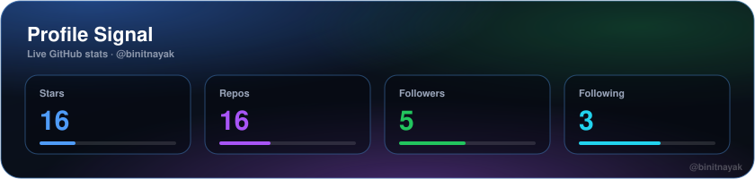
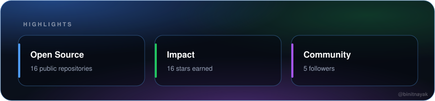

<h1 align="center">Hi, I'm Binit Nayak 👋</h1>

  

## 📌 About Me

> 💡 ✏️ *EDIT: A sentence about you and what you do.*

## 📊 GitHub Stats & Trophies

  
  

  

  

  

## 🛠️ Languages & Tools

### Programming Languages

### Frontend

### Backend

### Database

### DevOps & Cloud

### Tools

## 🔗 Connect with Me

  
  

  <picture>
    <source media="(prefers-color-scheme: dark)" srcset="https://raw.githubusercontent.com/binitnayak/binitnayak/output/github-contribution-grid-snake-dark.svg" />
    
  </picture>

Binit Nayak · cards generated by <code>generate_cards.py</code>

